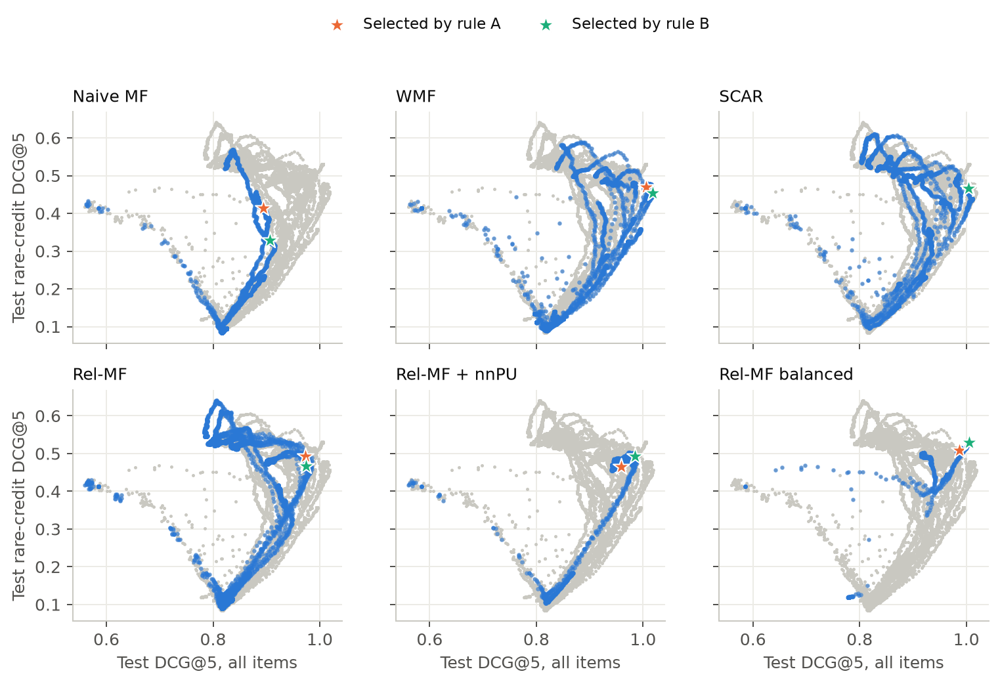
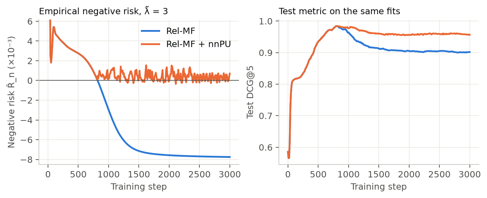

# Clicks are positive-unlabelled data

A click needs two things: the item was shown, and the user wanted it. A missing click says
little, since most items were never shown. Popular items are shown more and so clicked more,
and a model trained on clicks can mistake exposure for relevance. Offline tests on logged
traffic share the same bias, so they reward the same mistake.

Yahoo! R3 (songs) and Coat (a simulated coat shop) hold something rare: users in the logged data also rated items assigned uniformly at
random (5,400 of 15,400 on Yahoo, all 290 on Coat), which is what an exploration bucket logs. That traffic gives an unbiased test set. This
project re-implements [Rel-MF](https://arxiv.org/abs/1909.03601) (Saito et al., WSDM 2020), which re-weights clicks by an estimate
of how likely each item was to be shown, in PyTorch.

On Yahoo! R3, Rel-MF's DCG@5 beats naive matrix factorisation by +0.0883 (10.0%; 95% CI on the difference [+0.0764, +0.1013]) selecting on logged data, rule A, and by +0.0653 (7.2%; [+0.0530, +0.0787]) selecting on exploration data, rule B.
In this full-batch re-write, which tunes λ per family where the official code fixes it, the paper's Yahoo! ordering does not replicate: its baseline WMF, which up-weights positives by a tuned constant, gains more, 13.4% and 12.2%, and stays above Rel-MF on all items, with or without the [official code](https://github.com/usaito/unbiased-implicit-rec-real)'s weights. ExpoMF, its other baseline, was not run.
So the popularity-based weight is not needed for this gain on all items. It does lift rare items under the official code's far heavier positive weights: rare-credit is 17.8% above the nearest constant weight under rule B, with all items tied, and 4.4% above under rule A.

Terms used throughout:

* **Y** = click. In training, a rating of 4 or more on an item the user chose (Y = O · R).
* **O** = exposure. **R** = relevance, or "would click if shown". In the test set the item was assigned at random, so O = 1 by design and a rating of 4 or more measures R directly.
* **θ** = true exposure propensity, P(O = 1). **θ̂** = its estimate from item popularity (the paper's Eq. 12), `θ̂_i = (n_i / max n)^η`, with `n_i` the training positives of item `i` and η = 0.5 unless stated. **M** floors the estimate, `θ̄_i = max(θ̂_i, M)`, which caps the weight `1/θ̄_i` on clicks of rare items.
* **σ** = sigmoid of the user-item score. **λ̃** sets the L2 penalty relative to the weight on positives: `λ = λ̃ · w̄_pos`, with `w̄_pos` the mean weight on clicks.
* **c′** = a constant weight on positives: WMF's directly, SCAR's as `c′ = 1/c`, with **c** SCAR's constant exposure.
* **DCG@5** ranks each user's own test items, over users with at least one relevant test item; "all items" means every relevant item in that list scores. **Rare-credit DCG@5** ranks the same list but only scores relevant items from the 50% least popular, averaged over users with at least one such item (1,073 of 2,197 on Yahoo).
* **SNIPS** = self-normalised inverse propensity scoring. **ECE** = expected calibration error. **SCAR** = selected completely at random. **nnPU** = non-negative PU. Eq. numbers are the paper's.
* **Rule A** selects on the paper's statistic, per-user SNIPS on held-out logged positives. **Rule B** selects on `val_B`, a slice of 10% of the uniform-exposure users.
* **Balanced** is Rel-MF's popularity shape with positives weighted about 136 times more on Yahoo, the expected objective of the official code's 50/50 minibatches.

| # | Notebook | Question | Method |
|---|---|---|---|
| 01 | `01_exposure_bias` | What does exposure bias look like, and how extreme are the implied weights? | Self-selected vs uniform-exposure ratings, popularity concentration, θ̂ and weights by η, label frequency |
| 02 | `02_relmf` | Does Rel-MF beat naive MF and WMF on uniform-exposure test sets, and where does a gain come from? | Exact full-batch estimator; WMF, SCAR, Rel-MF, nnPU, balanced objective, BPR-MF, EASE; 3 seeds; user-level paired bootstrap; calibration |
| 03 | `03_offline_evaluation` | How much does a small exploration bucket improve model selection over SNIPS on logged data? | The same trajectories under different selection rules, selection regret, disjoint slices, metric conventions |

## Results

Yahoo! R3 test users, 3 seeds. 2,197 users have a relevant test item and 1,073 have a rare one.
CIs are 95% user-level paired bootstraps on seed-averaged per-user metrics. Ablations, calibration tables, other cut-offs and
Coat tables are in [`results/`](results/).

### Does Rel-MF beat naive MF? (notebook 02)

Rule A unless a column says B. The Rel-MF row has M = 0.1 under both rules (λ̃ = 3 under A, 0.3 under B). Rel-MF + nnPU (defined under "Why this is PU learning") and balanced are fitted only at M = 0, so their comparisons with that row also change M. `Rare@5` is rare-credit DCG@5.

|                                           |   DCG@5 |   Recall@5 |   AP@5 |   Rare@5 |   B: DCG@5 |   B: Rare@5 |
|:------------------------------------------|--------:|-----------:|-------:|---------:|-----------:|------------:|
| Random (analytic)                         |  0.5783 |     0.5000 | 0.2623 |   0.4289 |            |             |
| Popularity                                |  0.8166 |     0.6699 | 0.4350 |   0.0847 |     0.8166 |      0.0847 |
| Naive MF                                  |  0.8848 |     0.6979 | 0.4883 |   0.4385 |     0.9063 |      0.3397 |
| BPR-MF                                    |  0.9755 |     0.7622 | 0.5504 |   0.4371 |     0.9796 |      0.4339 |
| EASE                                      |  0.9134 |     0.6921 | 0.5130 |   0.4477 |     0.9715 |      0.4082 |
| WMF                                       |  1.0030 |     0.7801 | 0.5725 |   0.4719 |     1.0165 |      0.4521 |
| SCAR (constant θ)                         |  1.0049 |     0.7802 | 0.5745 |   0.4681 |     1.0052 |      0.4662 |
| Rel-MF                                    |  0.9732 |     0.7630 | 0.5515 |   0.4819 |     0.9716 |      0.4548 |
| Rel-MF + nnPU                             |  0.9587 |     0.7491 | 0.5416 |   0.4629 |     0.9775 |      0.4902 |
| Rel-MF balanced (official-code objective) |  0.9881 |     0.7647 | 0.5622 |   0.5105 |     1.0053 |      0.5294 |
| Ideal (analytic)                          |  1.5022 |     0.9932 | 1.0000 |   1.2594 |            |             |

Yes. DCG@5 rises by +0.0883 [+0.0764, +0.1013] under rule A, which is +10.0% and 14.3% of the headroom to an ideal ranking, and by
+0.0653 [+0.0530, +0.0787] under rule B. Rare-credit rises by +0.0434 [+0.0253, +0.0594] and +0.1152 [+0.0973, +0.1338]. All four CI lower bounds
are above 0 and all 3 seeds agree on the sign, which is the test I fixed after single-seed probes and before the grid. Rule A's size depends on naive MF's step budget: at its
earlier 3000 steps the two gains read +0.0711 (+7.9%) and +0.1068 (see the edge rule below).

That test is against naive MF, which the paper runs only in its semi-synthetic experiment on MovieLens 100K. Its Yahoo! baselines are WMF and ExpoMF.
Rel-MF falls below WMF here on all items (next table), at d = 100, the only dimension WMF was run at, and below the official λ; ExpoMF was not run, so the paper's Yahoo!
ordering is not replicated.

The paper's Rel-MF is +33% over WMF; here it is -3% (balanced -1%). On my re-implementation of the official evaluator at [commit 25cfa65](https://github.com/usaito/unbiased-implicit-rec-real/tree/25cfa65) (all 5,400 users, ranks 1 and 2 weighted equally, irrelevant items
scored 0.01), which the printed Figure 2 fits, a random ranking scores DCG@5 0.346. Read off that figure, the paper has WMF 0.364, ExpoMF 0.403 and Rel-MF
0.485, so its WMF sits 5% above random. The same evaluator reads this project's rule A fits as naive MF 0.498, Rel-MF 0.544 (+9.2%), balanced
0.553 and WMF 0.561 ([`results/03_conventions.md`](results/03_conventions.md)).

### Where does the gain come from? (notebook 02)

The families form a ladder. WMF adds a constant weight on positives. SCAR adds the PU correction on the negative term. Rel-MF makes
the weight depend on item popularity. Differences with 95% CIs, bold when the CI excludes 0:

| comparison                        | All items, rule A              | Rare-credit, rule A            | All items, rule B              | Rare-credit, rule B            |
|:----------------------------------|:-------------------------------|:-------------------------------|:-------------------------------|:-------------------------------|
| Rel-MF vs Naive MF                | **+0.0883** [+0.0764, +0.1013] | **+0.0434** [+0.0253, +0.0594] | **+0.0653** [+0.0530, +0.0787] | **+0.1152** [+0.0973, +0.1338] |
| WMF vs Naive MF                   | **+0.1182** [+0.1050, +0.1318] | **+0.0334** [+0.0151, +0.0508] | **+0.1102** [+0.0960, +0.1241] | **+0.1125** [+0.0923, +0.1332] |
| SCAR vs WMF                       | +0.0019 [-0.0037, +0.0081]     | -0.0038 [-0.0119, +0.0046]     | **-0.0113** [-0.0202, -0.0015] | **+0.0140** [+0.0006, +0.0283] |
| Rel-MF vs SCAR                    | **-0.0318** [-0.0432, -0.0206] | +0.0138 [-0.0027, +0.0290]     | **-0.0336** [-0.0454, -0.0230] | -0.0114 [-0.0267, +0.0034]     |
| Rel-MF vs WMF                     | **-0.0299** [-0.0412, -0.0191] | +0.0100 [-0.0062, +0.0262]     | **-0.0449** [-0.0556, -0.0338] | +0.0027 [-0.0151, +0.0194]     |
| Rel-MF balanced vs WMF            | **-0.0149** [-0.0227, -0.0073] | **+0.0386** [+0.0277, +0.0492] | **-0.0112** [-0.0206, -0.0022] | **+0.0772** [+0.0656, +0.0898] |
| Rel-MF balanced vs SCAR           | **-0.0168** [-0.0265, -0.0070] | **+0.0424** [+0.0291, +0.0562] | +0.0001 [-0.0126, +0.0128]     | **+0.0632** [+0.0463, +0.0801] |
| Rel-MF balanced vs SCAR, c′ = 500 | **+0.0628** [+0.0530, +0.0731] | **+0.0217** [+0.0087, +0.0337] | +0.0036 [-0.0043, +0.0118]     | **+0.0802** [+0.0691, +0.0911] |
| Rel-MF + nnPU vs Rel-MF           | **-0.0145** [-0.0237, -0.0045] | **-0.0190** [-0.0325, -0.0051] | +0.0059 [-0.0007, +0.0122]     | **+0.0354** [+0.0266, +0.0443] |
| Rel-MF balanced vs Rel-MF         | **+0.0150** [+0.0026, +0.0280] | **+0.0286** [+0.0115, +0.0448] | **+0.0337** [+0.0206, +0.0465] | **+0.0745** [+0.0575, +0.0920] |
| EASE vs Rel-MF                    | **-0.0597** [-0.0753, -0.0448] | **-0.0343** [-0.0550, -0.0132] | -0.0001 [-0.0140, +0.0132]     | **-0.0467** [-0.0662, -0.0266] |
| BPR-MF vs Rel-MF                  | +0.0024 [-0.0084, +0.0140]     | **-0.0449** [-0.0591, -0.0297] | +0.0081 [-0.0032, +0.0186]     | **-0.0209** [-0.0356, -0.0044] |

* **A constant weight can replace the gain on all items.** WMF gains more than Rel-MF on all items and about the same on rare-credit, at c′ = 100 and 300. That shows the
  popularity shape is not needed for this gain. It does not show the shape adds nothing at Rel-MF's own weight (see the scale bullet).
* **Once each family tunes its own c′ and λ̃, the PU correction adds nothing clear.** The winners are SCAR at c′ = 30, λ̃ = 3 and WMF at λ̃ = 1, with c′ = 100 under rule A and 300 under
  rule B. SCAR minus WMF covers 0 on both metrics under rule A. Under rule B it is -0.0113 on all items and +0.0140 on rare-credit, with a lower bound of +0.0006, and that gap comes
  from WMF's scale: WMF's own move from c′ = 100 to 300 gives +0.0130 and -0.0230, and against WMF at c′ = 100 SCAR is +0.0016 and -0.0090 (3 seeds at rule B's step, no CI). The term alone,
  at the same c′ and λ̃, raises rare-credit in 15 of 16 cells under rule B and 13 of 16 under rule A, and splits all items, 12 and 8 of 16 (seed 42, no CIs). It moves a fixed configuration,
  and tuning absorbs it.
* **Against constants tuned to a much higher scale, Rel-MF does not win.** It is 3.0% below WMF (c′ = 100) and 3.2% below SCAR (c′ = 30) on all items under rule A, and neither difference on rare-credit excludes 0.
* **Scale is the knob Rel-MF lacks.** Its `θ̂`, at η = 0.5 and clipped at M = 0.1, sets the mean weight on positives to 3.65, and moving η or M changes the shape as well. WMF and SCAR tune theirs directly.
  On seed 42, with rule A inside each cell and no CIs, the constant families reach at most 0.9303 on all items and 0.3575 on rare-credit at c′ = 3, the nearest cell, and 0.9744 and 0.4298 at c′ = 10, 2.7 times
  that scale, against Rel-MF's 0.9729 and 0.4935. They pull ahead on all items at c′ of 30 or more, except SCAR at c′ = 500, the control below (0.9251).
* **At the same high scale, the popularity shape lifts rare items.** Balanced weights positives about 500 times an unlabelled pair on average. The nearest control, SCAR at c′ = 500, has no shape but a stronger PU term, -499 on each positive against balanced's mean of -366; the exact shape-free objective was not fitted. Against it balanced ties on all items under rule B, +0.0036 [-0.0043, +0.0118], and is higher on rare-credit,
  +0.0802 [+0.0691, +0.0911]. Under rule A balanced is higher on both, +0.0628 [+0.0530, +0.0731] and +0.0217 [+0.0087, +0.0337], but the all-item gap comes from rule A picking SCAR's lowest λ̃ (0.9251 / 0.4931): at balanced's λ̃ = 0.3 SCAR scores 0.9876 / 0.4896 against 0.9869 / 0.5081 (scores: seed 42).
* **Against the tuned constants balanced trades a little all-item accuracy for rare items.** It beats WMF on rare-credit by +0.0386 [+0.0277, +0.0492] under rule A and +0.0772 [+0.0656, +0.0898] under rule B, and is 1.5% and 1.1% lower on all items. A large constant does not do this alone: WMF at c′ = 300 and 1000, either side of
  balanced's scale, reaches rare-credit 0.4737 and 0.4759 under rule A against balanced's 0.5081, and under rule B no constant at any c′ exceeds 0.4777 against balanced's 0.5298. A smaller constant can match it under rule A: WMF at c′ = 30 scores 0.9882 / 0.5132 against balanced's 0.9869 / 0.5081, but only steps 310 to 330 of that fit beat balanced on both, and rule B gives it 0.9980 / 0.4127 (these two sentences: seed 42).
* **The lift is against popular items.** Among rare items alone (the restricted reading), balanced beats neither WMF nor SCAR. Under rule A both order them better, DCG@1 0.5266 each against balanced's 0.5039, differences +0.0227 [+0.0068, +0.0410] and +0.0227 [+0.0009, +0.0460]. Under rule B they tie, 0.5294 and 0.5228 against 0.5390, differences
  -0.0096 [-0.0267, +0.0093] and -0.0162 [-0.0413, +0.0093]. Plain Rel-MF is the lowest of the four under both rules (0.4986, 0.5023).
* **A penalty at ranking time does about as well at DCG@5.** Applied to the rule B WMF fits with no training, `score − α · sd(score) · log(n_i + 1)`, with per-seed α (0.26, 0.24, 0.22) set on `val_B` to reach balanced's rare-credit, differs from balanced by -0.0006 [-0.0086, +0.0079] on all items and +0.0046 [-0.0060, +0.0157] on rare-credit. With this α, set at DCG@5, it is below balanced on rare-credit at DCG@1 and DCG@3,
  -0.0205 [-0.0342, -0.0068] and -0.0115 [-0.0223, -0.0006], but the gap moves with α: set at DCG@1 (0.28, 0.28, 0.34) the two gaps are -0.0087 [-0.0217, +0.0040] and +0.0110 [-0.0010, +0.0226]. With per-seed α (0.10, 0.18, 0.18) maximising all-item DCG@5 on `val_B` it adds +0.0515 [+0.0445, +0.0584] to WMF's rare-credit for -0.0047 [-0.0100, +0.0007] on all items. I tried this after seeing the results, with one penalty form.
* **No stronger model family beats Rel-MF.** BPR-MF ties it on all items. EASE ties it under rule B and is lower under rule A. Both are
  lower on rare-credit under both rules. The families above Rel-MF on all items are WMF, SCAR and balanced, the same model with different weights.

For a team this suggests an order of work: tune the positive weight first, then try a popularity penalty at ranking time, and re-train with a popularity-shaped objective only if no α meets the rare-item target.

Each panel is every grid (configuration, step) at seed 42: its family in blue, the other five in gray, stars where rules A and B select. The first Results table averages 3 seeds, so the stars sit a little away from its rows. Rare-credit starts near
its random level and falls while the model learns popularity, to about 0.1 to 0.3 at λ̃ ≤ 1. Balanced is the exception: at λ̃ ≤ 1 it rises to about 0.46 and only dips to about 0.40. At small λ̃ rare-credit
then recovers; at λ̃ = 10 it stays low. One number hides the trade-off.



### When the unbiased risk goes negative (notebook 02)



At λ̃ = 3, M = 0, seed 42, `R̂_n` (defined under "Why this is PU learning") crosses zero at step 820 and test DCG@5 has just peaked at 0.9842 at step 800. Plain Rel-MF then falls to
0.9020. With nnPU the two fits are the same until the crossing, and it ends at 0.9563. Over 3 seeds the last-step difference between the rule A
winners (Rel-MF at M = 0.1, nnPU at M = 0) is +0.0551 [+0.0468, +0.0630].

So nnPU protects a model that trains too long, on all items and among rare items alone (restricted DCG@1 +0.0295 [+0.0155, +0.0444]). It does not protect rare-credit, -0.0103 [-0.0198, +0.0001] and under rule B -0.0595 [-0.0717, -0.0462]: late Rel-MF puts more rare items above popular ones, which that reading rewards. Its effect on the peak depends on where the crossing falls. At λ̃ = 3 the crossing comes after the peak, so nnPU cannot lower that peak, and here it does not
raise it either. At λ̃ ≤ 1 `R̂_n` crosses first (steps 320 to 430, against Rel-MF peaks at steps 430 to 500), and nnPU's peak is higher by 0.0090 to 0.0205 (seed 42, read from the test curve). Its best
point across λ̃ is 0.9886 against 0.9854 for Rel-MF across M. That gap is one seed, about the size of the seed spread, and no validation rule selects that point.

Between the rule A winners the difference at the selected step is -0.0145 [-0.0237, -0.0045], which misses my expectation of "no lower". Rule A picks nnPU late (steps 2090 to 2170, long after the test peak), and that alone covers it: at Rel-MF's own selected steps nnPU is +0.0080, -0.0004 and +0.0034 by seed (no CI). The winners also differ in M, which these fits do not size: at M = 0 on both sides (λ̃ = 3, seed 42, no CI) the difference is -0.0022, but -0.0149 to +0.0023 across plain Rel-MF's steps within 0.0005 of rule A's maximum. Under rule B the
difference is +0.0059 [-0.0007, +0.0122], with rare-credit higher by +0.0354 [+0.0266, +0.0443].

A negative `R̂_n` alone does not predict the fall. On the SCAR and balanced rule A winners it is below zero from step 40 and from step 0, before test DCG@5 peaks at steps 280 to 520 and 660 to 1290, and it ends at -0.1159 and -1.2616,
each on its own weight scale. From test peak to last step they lose 0.0034 to 0.0095 and 0.0037 to 0.0083 across seeds, against 0.0827 to 0.0863 for Rel-MF (M = 0.1), whose `R̂_n` first goes below zero at step 840, after its peak at
steps 790 to 820. I did not establish why they differ.

### Selecting on logged data or on a small exploration bucket (notebook 03)

Every rule reads the same trajectories at seed 42. A0 is rule A with unit weights: per-user DCG@5 divided by the user's number of held-out logged positives. A is per-user SNIPS, A+ is pooled SNIPS. B reads `val_B`; B5 and B2.5 read its
disjoint halves and quarters. `regret` is the best test DCG@5 in a pool minus the test DCG@5 of the rule's pick from that pool. The pool is every grid fit at seed 42 in the `regret` column, plain Rel-MF fits (η = 0.5, no nnPU or balanced) in `Rel-MF only: regret`, so its picks are not those in `picks`, and one family's fits where a bullet below quotes a family's regret. `reads` counts the users in that slice with a relevant item: 239 of `val_B`'s 540 users, split across halves of 270 and quarters of 135. BPR-MF's step is an epoch; the pointwise families' steps are full-batch updates.

| rule   | reads          | picks                             |   step |   test DCG@5 |   rare-credit |   regret |   Rel-MF only: regret |
|:-------|:---------------|:----------------------------------|-------:|-------------:|--------------:|---------:|----------------------:|
| A0     | logged holdout | WMF (c′=100, λ̃=1)                 |   1110 |       1.0042 |        0.4700 |   0.0145 |                0.0051 |
| A      | logged holdout | WMF (c′=100, λ̃=1)                 |   1170 |       1.0051 |        0.4698 |   0.0135 |                0.0125 |
| A+     | logged holdout | Rel-MF + nnPU (η=0.5, M=0, λ̃=3)   |   1440 |       0.9612 |        0.4742 |   0.0575 |                0.0285 |
| B      | 239 users      | SCAR (c=1/30, λ̃=3)                |   1820 |       1.0045 |        0.4658 |   0.0141 |                0.0108 |
| B5a    | 132 users      | SCAR (c=1/10, λ̃=3)                |    470 |       0.9768 |        0.4009 |   0.0418 |                0.0526 |
| B5b    | 107 users      | Rel-MF balanced (η=0.5, M=0, λ̃=1) |   1000 |       1.0049 |        0.5305 |   0.0138 |                0.0219 |
| B2.5a  | 58 users       | SCAR (c=1/10, λ̃=3)                |    470 |       0.9768 |        0.4009 |   0.0418 |                0.0111 |
| B2.5b  | 74 users       | BPR-MF (reg=0.01)                 |     76 |       0.9733 |        0.4213 |   0.0453 |                0.0541 |
| B2.5c  | 52 users       | Rel-MF balanced (η=0.5, M=0, λ̃=1) |    810 |       1.0034 |        0.5275 |   0.0153 |                0.0219 |
| B2.5d  | 55 users       | Rel-MF balanced (η=0.5, M=0, λ̃=1) |   1840 |       1.0051 |        0.5290 |   0.0136 |                0.0206 |
| oracle | test set       | WMF (c′=300, λ̃=1)                 |    680 |       1.0187 |        0.4559 |   0.0000 |                0.0000 |

* **`val_B` beats logged data in 4 of 7 families and ties in the other 3.** `val_B` is 540 users with 10 random items each: 10% of the uniform-exposure users, 3.5% of all users. Over 3 seeds, rule B's test DCG@5 minus rule A's is +0.0214 [+0.0084, +0.0335] on naive MF, +0.0135 [+0.0040, +0.0220] on WMF,
  +0.0188 [+0.0077, +0.0289] on nnPU and +0.0172 [+0.0058, +0.0286] on balanced. SCAR (+0.0002 [-0.0020, +0.0024]), BPR-MF (+0.0041 [-0.0019, +0.0106]) and Rel-MF (-0.0016 [-0.0107, +0.0074]) cover 0. At seed 42 rule B has lower regret than rule A in 6 of 7 families, from 0.0006 against 0.0191 on balanced to 0.0163
  against 0.0164 on BPR-MF, with SCAR at 0.0066 against 0.0061. On Rel-MF unweighted A0 has the lowest regret, 0.0051.
* **Across all models A0, A and B tie,** at 0.0145, 0.0135 and 0.0141, and all three land on a constant-weight family. The slice cannot rank those close families: at seed 42, WMF minus SCAR on `val_B` is -0.0031 [-0.0320, +0.0267], while on test it is +0.0130. WMF minus Rel-MF, a wider gap, excludes 0 only on 3 seeds:
  +0.0393 [+0.0055, +0.0747], against +0.0306 [-0.0083, +0.0701] at seed 42. These are paired over the same 239 users, on fits selected on this slice.
* **Per-user SNIPS adds little here, and pooled SNIPS selects badly.** With one positive in a candidate list, per-user SNIPS cancels the weight, and A correlates with A0 at 0.824 to 0.984. Pooled SNIPS does not cancel it, and it has the largest regret of A0, A, A+ and B in 5 of 7 families.
* **Smaller slices are erratic.** The two 5% halves have regret 0.0418 and 0.0138, and the four 2.5% quarters run from 0.0136 to 0.0453 across three different families.

### Calibration (notebook 02)

Rule A winners unless noted. Naive MF's `σ` averages 0.0165 on test rows where the relevance rate is 0.0887, and Rel-MF's averages 0.0672. Dividing `σ` by one constant, `ĉ = mean σ / mean R` on `val_B`, takes the ECE of `σ` averaged over the 3 seeds from 0.0721 to 0.0178 and from 0.0241 to 0.0166; fit by fit it lands near 0.016 for both.
Three expectations failed. That ECE is not small: a constant at `val_B`'s relevance rate, which ranks nothing, scores 0.0072. Rel-MF's ĉ is 0.82, where I expected below 0.36, the share of users who rated the most-rated item. That share is only a floor on exposure; the click and relevance rates of the hottest item, where Eq. 12 sets `θ̂ = 1`, imply about 0.38, so 0.82 still misses. And `σ_naive / σ_Rel-MF` should equal `max(θ̂, 0.1)` at the population minimiser, whatever the true exposure, because
both Rel-MF winners clip at M = 0.1. Across popularity bins that target runs from 0.10 to 0.48, yet the ratio stays between 0.23 and 0.26, and under rule B it falls from 0.56 to 0.31. The fits chosen for ranking are far from that minimiser: across popularity bins naive MF's `σ` runs from 0.0125 to 0.0261 while the training click rate runs from 0.0007 to 0.0393.
Under rule A the level of `σ` orders by `λ = λ̃ · w̄_pos` per unit of unlabelled weight, not by the positive weights alone: 0.0672 for Rel-MF (λ = 11), 0.1538 for SCAR at c′ = 500 (50), 0.2130 for WMF (100) and 0.2888 for balanced (151). The minimiser at each item's click rate has no λ̃ and rises with the weights over a wider range (0.0267, 0.8978, 0.2956 and 0.9977 for the same four).

### Coat (notebook 02)

Directional only: 200 test users with a relevant item and no reference numbers. Rel-MF is above naive MF on all items, +0.1066 [+0.0558, +0.1625] under rule A and +0.0631 [+0.0035, +0.1162] under
rule B. Rare-credit splits, -0.0364 [-0.0918, +0.0207] and +0.1329 [+0.0873, +0.1853]. Popularity (0.9627) and Rel-MF (0.9570) do not separate under rule A, +0.0058 [-0.0732, +0.0798]. The nnPU and balanced comparisons
all cover 0. Under rule B nnPU equals Rel-MF exactly, because every seed's selected step comes before `R̂_n` first goes negative.

## Why this is PU learning

With `Y = O · R`, a positive label means relevant and shown, and an unlabelled pair may be either
irrelevant or never shown. That is positive-unlabelled data, and the exposure propensity θ plays the
role of the labelling propensity:

* **SCAR** (Elkan & Noto 2008): the labelling probability is a constant `c`. Setting `θ ≡ c` in Eq. 9 gives the unbiased PU risk of du Plessis et al.
* **SAR** (selected at random; Bekker et al. 2019): the propensity `e` varies with features. Rel-MF takes `e = θ̂_i`, a function of item popularity only.
* **nnPU** (Kiryo et al. 2017): the negative-class risk `R̂_n = (1/|D|) Σ (1 − Y/θ̄) σ²`, with `D` all user-item pairs, has a non-negative expectation, but its empirical value goes negative under a flexible model, which Kiryo et al. read as overfitting. Algorithm 1 takes a step on `−R̂_n` when that happens.

`J = Σ [ w¹ (1 − σ)² + w⁰ σ² ] + (λ/2)(‖U‖² + ‖V‖²)` with `σ = sigmoid(u · v)` is the objective of every pointwise
family. They differ in `(w¹, w⁰)`, except Rel-MF + nnPU, which keeps Rel-MF's weights at M = 0 and changes the step when
`R̂_n < 0`. BPR-MF and EASE are separate baselines with their own objectives. `tests/test_core.py` enumerates all
outcomes of `(O, R)` on a toy matrix to check that the expected Rel-MF loss at `θ̂ = θ` and M = 0 (Eq. 9) equals the ideal loss to 12 decimal places.

## In production

At a marketplace such as Grab the same structure applies with better inputs. `θ̂` would come from impression and
position logs instead of popularity. The uniform slice of notebook 03 is an exploration bucket. Position bias, which
this version does not model, would enter as a further factor in θ. Calibration is the part that matters for a bid. At the population
minimiser `σ` estimates the relevance rate under uniform exposure up to the factor `θ/θ̂`, which is a different quantity from
pCTR under the logging policy. The fits selected for ranking here do not reach that minimiser, so `σ` needs its own calibration
on exploration traffic before it enters a bid.

## Data

| | Coat | Yahoo! R3 |
|---|---|---|
| Users × items | 290 × 300 | 15,400 × 1,000 |
| Self-selected ratings | 6,960 | 311,704 |
| Uniform-exposure ratings | 4,640 | 54,000 |
| Source | [Cornell](https://www.cs.cornell.edu/~schnabts/mnar/) (Schnabel et al. 2016) | [AutoDebias mirror](https://github.com/DongHande/AutoDebias) of Webscope R3 (Marlin & Zemel 2009) |

`make data` downloads both and checks their checksums. The mirror's counts (311,704 + 54,000 rows, 15,400 users, 1,000 items, 10 random items for each of 5,400 users) are the ones Ling et al. (UAI 2012, Sec. 4.1) print
for the Webscope release. Marlin & Zemel (2009, Sec. 4) agree on all of them except the self-selected rows, which they give as approximately 250,000. Cell-level identity with the Webscope release is unverified. As far as I know the Webscope terms do not allow
redistribution (I have not checked the agreement text), so raw data is not in this repository. A Webscope copy converted to the same format can be
dropped into `data/raw/yahoo/`, and `src/data.py` asserts the row counts.

## Reproduce

Needs [uv](https://docs.astral.sh/uv/). `data/` is git-ignored, so `make notebooks` needs `make grid` first; `results/` already holds the tables and figures.

```bash
make all          # uv env -> download -> tests -> grid, finals, sensitivity -> execute the notebooks
```

Pieces: `make env`, `make data`, `make test`, `make grid`, `make notebooks`. Everything runs on a laptop CPU. One process takes about 5 hours on an Apple-silicon laptop:
about 370,000 training steps on Yahoo at about 48 ms each, one thread, plus 3 minutes for Coat and 2 minutes for BPR-MF and EASE.
Finished fits are skipped on restart. Seeds are fixed in `src/config.py`, and training uses one thread per process, so a fit is byte-for-byte repeatable
on the same machine, apart from its logged `wall` times. Parallel workers do not change results, and finals need the whole grid first. On my laptop eight workers reached only about 1.2 times the throughput of one process. I did not establish why. To run workers anyway:

```bash
make data
for phase in grid finals sens; do
  for i in 0 1 2 3; do uv run python src/run_grid.py --phase $phase --shard $i/4 & done; wait
done
```

Notebooks are stored as jupytext percent-format `.py` files and read `data/raw/` and `data/processed/`. They never train and never import torch. `make notebooks` executes them into `notebooks/*.ipynb`, the copies with outputs.

## Layout

```
src/config.py     paths, seeds, the experiment grid, selection rules
src/download.py   fetch Coat and Yahoo! R3
src/data.py       parse, split, propensity, rare mask, validation candidates, per-user lists
src/models.py     pointwise trainer (weights + nnPU switch), BPR-MF, EASE, popularity
src/evaluate.py   per-user metrics, SNIPS, analytic floors, paired bootstrap, calibration, selection
src/run_grid.py   grid, control, finals, sensitivity; appends to data/processed
notebooks/        the three notebooks (jupytext, plus executed .ipynb)
tests/test_core.py   unbiasedness by enumeration, metric hand examples, nnPU branch
results/          markdown tables and figures written by the notebooks
```

## Design decisions and caveats

**Probe before the grid.** Before finalising my project plan (not in this repo) I ran single-seed probes on Yahoo! R3 and saw seed-42 test metrics. They set the λ̃ range and the step budgets (`val_B` showed the same shapes), and the expectations I read results against were written after them. So nothing here is pre-registered. In the grid itself, selection reads only validation columns. Test metrics are logged for plots and regret.

**Edge rule.** The plan said: if a main-table winner lands in the last 5% of its step budget or on the edge of its λ̃ grid, double the budget or extend the grid by one cell, then re-fit. The step budgets and some λ̃ grids moved that way, once. Other grids took more rounds or more cells, or sit outside the rule (`src/config.py`):

* Step budgets: naive MF 3000 to 6000; SCAR, nnPU and balanced 1500 to 3000. Rel-MF went to 3000 as well, so its last-step comparison with nnPU happens at the same step. WMF and η = 1 stay at 1500 because their seed-42 winners are interior; WMF's rule A pick at seed 44 lands on step 1500, on a plateau.
* λ̃, as the rule says: 0.1 for Rel-MF, nnPU and balanced on Yahoo, and for WMF on Coat.
* λ̃ on Coat, two rounds: 0.1 for naive and balanced, then, after 0.1 won, 0.03 for naive and 0.03 and 0.01 for balanced.
* Outside the rule, which names only λ̃: WMF c′ = 300 because c′ = 100 won on Yahoo under both rules, then 1000 because c′ = 300 won there under rule B (the paper stops at 100). BPR-MF regularisation 0.1 and 1, and EASE λ = 10, 30 and 10000, more than one cell each. SCAR's winners stayed interior, so its grid stops at c′ = 100.
* I stopped after these extensions. At seed 42, SCAR's and balanced's rule A winners now sit at the end of their budgets (steps 3000 and 2970), on a plateau. Over 3 seeds, re-picking on the same fits, the doubling moved their DCG@5 by -0.0009 and -0.0007 and their rare-credit by +0.0035 and +0.0020. nnPU's rule A picks moved too, staying mid-budget, from 1430, 1500, 1360 to 2140, 2090, 2170: DCG@5 -0.0027, rare-credit -0.0059, and its gap to Rel-MF at the selected step from -0.0118 to -0.0145 (no CI).
* The doubling did move naive MF, the headline's baseline. Its rule A picks went from steps 2910, 3000, 3000 to 4000, 5760, 5660, while its rule B picks and Rel-MF's picks stayed where they were. Over 3 seeds naive MF's rule A DCG@5 fell from 0.9021 to 0.8848 and its rare-credit rose from 0.3751 to 0.4385. At the old budget Rel-MF's rule A gain would read +0.0711 (+7.9%) on all items and +0.1068 on rare-credit, against +0.0883 (+10.0%) and +0.0434 in the tables, and WMF's +13.4% would read +11.2%. The sign holds in all seeds at both budgets. These old-budget values are point estimates read from the trajectories, with no CI.
* η = 0.25 is not a main-table family, so the rule did not require it. I doubled its budget to 3000 anyway, because its rule A pick sat on step 1500 with validation still rising. Its rare-credit gap to η = 0.5 then shrank from -0.1519 to -0.0801 [-0.0966, -0.0626].
* SCAR at c′ = 500 is a control I added after the first results and after an audit of them. Balanced weights positives about 500 times unlabelled pairs on average, and without this cell nothing near that scale has the PU term and no shape. It stays outside the SCAR grid, so the SCAR winner does not move. Coat's SCAR grid comes close to balanced's scale there (c′ = 100 against about 129).

**Selection statistics.** Rule A is the paper's per-user SNIPS. With one positive in a user's list the weight cancels, so for most validation users it equals the unweighted statistic (see notebook 03). Finals re-fit the configurations rules A and B chose at seed 42 with seeds 42, 43, 44 (one fit for popularity and EASE, which are deterministic; η = 0.25 and η = 1 rule A only) and re-select the step per seed.

**Confidence intervals** are per comparison, with no correction for how many comparisons there are. They resample users with the models fixed, so seed noise shows only in the "all seeds agree" check. SCAR over WMF on rare-credit under rule B, with a lower bound of +0.0006, is the kind of result that could arise by chance, and so is SCAR over balanced on restricted DCG@1 under rule A, with a lower bound of +0.0009.

**Rare items.** Rare means the bottom 50% of items by training positives (500 on Yahoo, n_i ≤ 47). Rare-credit keeps each user's whole list; the restricted reading drops the other items, as the official code does at `n_i ≤ 500`, and here Recall@5 saturates because Yahoo users keep about 5 of 10 candidates.

**Calibration** uses only uniform-exposure rows. It tests what `σ` estimates, not whether it is ready for a bid: there are no position logs and no pCTR target here.

**What was left out on purpose:** ExpoMF, iALS, log loss, full-catalogue ranking, position bias, propensities that depend on the user.

**Expectations against outcomes.** Written after the probes and before the grid.

| # | Expected | Outcome |
|---|---|---|
| 1 | Rel-MF above naive MF on DCG@5 | Held under both rules. The paper's own Yahoo! ordering, above WMF, did not |
| 2 | The same on rare-credit | Held under both rules |
| 3 | WMF and SCAR no worse than Rel-MF on all items; on rare-credit Rel-MF ≥ SCAR ≥ WMF | All items: held, and both are above it. Rare-credit: no such order, Rel-MF separates from neither |
| 4 | At η = 0.5, M = 0.1 near M = 0 and M = 0.3 towards SCAR; at η = 1, M > 0 helps | Held at η = 0.5. At η = 1, on all items, seed 42: under rule A, M = 0.1 helps and M = 0.03 does not (0.8993 to 0.9508, 0.8910); under rule B both help (0.9470 to 0.9726, 0.9733) |
| 5 | `R̂_n` crosses zero near the test peak and test then falls; nnPU higher at the last step and no lower at the selected step | Held, except the selected step under rule A, which is lower from rule A's late pick on nnPU. At equal M, seed 42 only, it is -0.0022, but -0.0149 to +0.0023 across rule A's near-ties, so M's share is not sized |
| 6 | Balanced no lower than Rel-MF on both metrics | Held, and higher under both rules |
| 7 | EASE and BPR-MF close to Rel-MF on all items | BPR-MF held. EASE only under rule B, lower under rule A |
| 8 | Regret of B below A; A and A0 correlated; A+ picks higher rare-credit; 2.5% slices disagree | B below A in 6 of 7 families at seed 42; over 3 seeds 4 of 7 have a CI above 0 and 3 cover 0. A tie across all models. A and A0 correlated and the slices disagree. A+ higher by 0.0044 at seed 42; the same two configurations, with the step re-selected per seed, give +0.0005 at seed 43 and -0.0033 at seed 44, so the sign is not stable |
| 9 | Naive `σ` far below the relevance rate; Rel-MF low with ĉ < 0.36; small ECE after ĉ; `σ_naive / σ_Rel-MF` follows `θ̂` | First held. ĉ = 0.82. ECE 0.0166 after ĉ (σ averaged over 3 seeds; near 0.016 fit by fit), not small: a constant at `val_B`'s relevance rate, which ranks nothing, scores 0.0072. The ratio does not follow it, flat under rule A and falling under rule B, and a wrong η cannot explain that because true exposure cancels in it |
| 10 | Coat CIs mostly cover 0 | 11 of 16 do |

### Deviations from the paper and the official code

| Topic | Paper or official code | Here |
|---|---|---|
| Framework | TensorFlow 1.15 | PyTorch, re-written; the official code was read, not run |
| Estimator | Balanced minibatches, 2¹⁴ positives + 2¹⁴ unlabelled (code); the exact sum is written in the paper | Exact full-batch sum. The official objective's expectation is the balanced family |
| Objective scale | `1/\|D\|` (paper); mean over the 50/50 batch (code) | Multiplied by `\|D\|`, with `λ = λ̃ · w̄_pos`. On Yahoo, under `1/\|D\|` most user-coordinate gradients fall below Adam's eps, and the code's `λ = 1e-4` collapses the model to `σ = 0.5` |
| Stopping | 301 steps, last step (code) | Fixed budget, step chosen on validation |
| Tuning | Optuna, d in {30, …, 200} (paper; the script is not public) | Grid, d = 100, sensitivity at 30 and 200 |
| Selection | Per-user SNIPS (paper), none in code | A0, A, A+, B, B5, B2.5 on the same trajectories |
| Test users | All users; Recall = k/10 for zero-positive users (code) | Users with at least one relevant test item; 10% of uniform-exposure users held out as `val_B`. On Yahoo, averaging over all test users (2,197 of 4,860 have a relevant item) would multiply DCG and AP by about 0.45 |
| Validation split | Split all rows, keep positives (code) | 10% of positives directly |
| SNIPS negatives, 100 sampled per user (paper, code, here) | From items seen in validation (code) | From the catalogue minus the user's positives (paper's "unlabeled"), drawn once |
| Propensity counts | Positives in the 90% split, validation excluded (code); "in the training set" (paper, Sec. 6.2.1), not saying whether validation positives count | As in the code: training positives without the held-out 10% |
| Metrics | DCG with ranks 1 and 2 weighted equally, MAP without normalisation (code) | Paper's DCG discount, standard AP. Notebook 03 prints both |
| Ties | `argsort()[::-1]`, so the later test row wins (code) | Lower item id. Among the final fits at selected steps this moves only Popularity and EASE. Breaking ties the other way moves DCG@5 by at most 0.0005 on Yahoo and 0.0074 on Coat, and rare-credit by at most 0.0019, and changes no conclusion |
| Rare | `n_i ≤ 500` (code; 96% of Yahoo items), bottom 500 (paper) | Bottom 50%, plus the rare-credit reading |
| WMF weight | 0.977 on unlabelled pairs inside the 50/50 minibatches, c′ ≈ 139 in expectation (code) | c′ on clicked pairs, as in Eq. 6 |
| Added | | BPR-MF, EASE, popularity, SCAR, balanced, nnPU, η variants, M outside the paper's range, Coat, 3 seeds with a paired bootstrap |
| Coat | Not in the paper | Added, with overlapping train and test cells removed; no reference numbers exist |
| Yahoo! R3 | Webscope | The AutoDebias mirror |

### Reproducibility notes on the paper and its code

Notes 2 to 5 are facts I checked in the paper, [the public code](https://github.com/usaito/unbiased-implicit-rec-real) and its history. Notes 1 and 6 also use read-offs from the figures, accurate to about ±0.001. Nothing public records which code state or run produced the printed figure, so anything I say about that is an inference and is labelled as one.

1. The figure printed in the paper ([arXiv](https://arxiv.org/abs/1909.03601) v2 and v3, p. 8) reads DCG@1 0.119 to 0.190 on all items. As an inference from read-offs, it fits the evaluator at commit 25cfa65: all 5,400 users, each user's own 10 items, relevance floor 0.01, official discount. `(DCG@1 − MAP@1) / (1 − MAP@1)` gives a floor of about 0.010 (HEAD uses 0.001), and on that evaluator a random ranking scores DCG@1 0.097, DCG@5 0.346 and Recall@5 0.500, just below the printed WMF (0.119, 0.364, 0.502). Its rare panels fit that commit's `n ≤ 500` rule (n: all positives plus every test row), not 500 of 1,000 items: a random ranking scores Recall@5 0.526 under that rule and 0.913 on the bottom 500, and the printed WMF reads 0.526. The six PNGs in the repository, which its README also labels Figure 2, are a different plot: DCG@1 reads 0.012 to 0.019, and the DCG and MAP panels read about a tenth of print. Neither public average-over-all evaluator can produce them: on all items any ranking scores at least 0.27 on Recall@5, and the PNGs read 0.05 to 0.06.
2. Commit 25cfa65 (2020-02-09) stores propensities with `pscore.astype(np.int)` in `data_generator.py`. That truncates every item except the hottest to 0, and training then clips them to M = 0.0091, so every positive outside the hottest item gets the same weight of about 109. The same commit adds the six PNGs. The printed images are already in arXiv v2 (2019-12-13), before the repository's first commit, and v3 (2020-02-09) keeps them. HEAD, ff1435e (2020-02-27), stores floats, and the PNGs are byte-identical. The training runs behind the two figures cannot be identified, so whether the cast affected them cannot be established.
3. The official code draws balanced minibatches, which up-weights positives about 136 times beyond Eq. 11. Its evaluator resets `np.random.seed`, so only 25 distinct batches cycle 12 times.
4. The official code uses no validation set and takes the last of 301 steps. The tuning script is not public. The stored best M = 0.0091 is outside the paper's [0.01, 0.1]. The stored WMF weight of 0.977 on the unlabelled term equals c = 1.02 in Eq. 6 before sampling, inside the paper's [1, 100]. WMF goes through the same 50/50 minibatches as Rel-MF (note 3), so in expectation a clicked pair weighs about 139 times an unlabelled pair, where this project's naive MF weighs them equally. By its weights the code's WMF is closest to this project's WMF row (c′ = 100 under rule A, 300 under rule B), and its Rel-MF to the balanced row. It stores d = 30 for WMF and d = 200 for Rel-MF.
5. The official metrics differ from the paper's formulas: ranks 1 and 2 share a discount; MAP sums precision only at hit positions where the printed formula sums it at every cutoff up to K, so one hit at rank 1 scores 1 in the code and 2.28 in the paper at K = 5; zero-positive users get Recall = k/10; rare means at most 500 positives. Neither MAP is standard AP: neither divides by `min(K, n_rel)`.
6. The paper's text says Rel-MF improves Recall@5 by 9.6% over ExpoMF on all items and by 6.4% over the best baseline on rare items. Figure 2 as printed gives the same gains within read-off error (0.582 against 0.531, and 0.593 against 0.558), and it matches the text's DCG and MAP gains too, except rare MAP@5, 11.2% in the text and about 12.4% read off. The repository's PNGs give Recall@5 gains of +18% and +13%.
